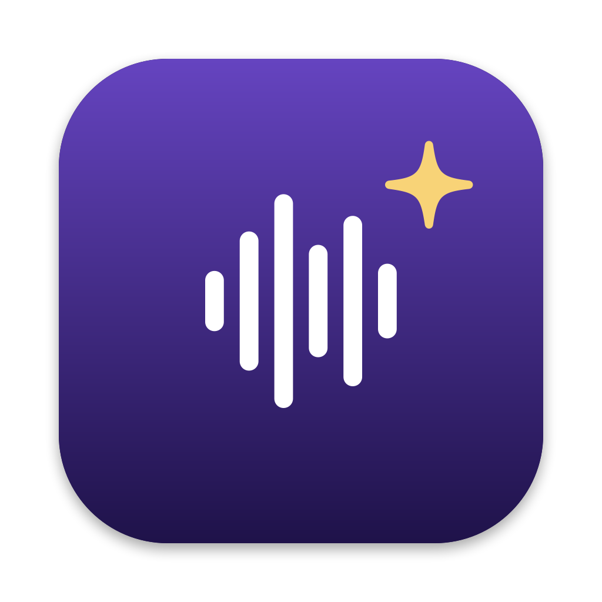
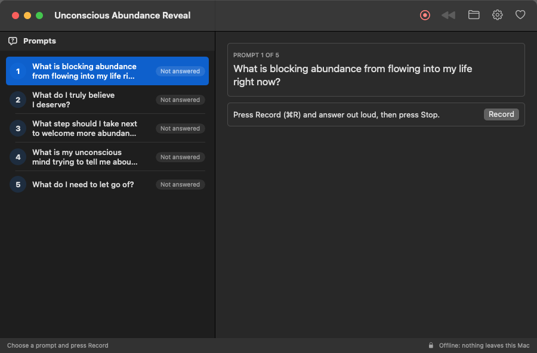

# Unconscious Abundance Reveal



A Mac app that records your spoken answer to a guided prompt, plays it **backwards**, and transcribes the
reversed recording to reveal guidance from the unconscious mind. Choose a prompt, press **Record**, answer out
loud, and press **Stop**: the reversed answer plays and the words hidden in it appear.

Everything runs on your Mac. Nothing is uploaded, and the app can't go online at all.



## Download

**[Unconscious Abundance Reveal (offline).dmg](https://github.com/TechnAudioToolz/unconscious-abundance-reveal/releases/latest)**:
the whole app, under 1 MB. It needs no internet connection, ever: recording, reversing and speech
recognition all use what comes with macOS.

1. Open the DMG and drag Unconscious Abundance Reveal onto Applications.
2. The first time, macOS may say it can't check the app (it's free and not registered with Apple):
   System Settings > Privacy and Security > scroll down > **Open Anyway**. Only once.
3. If the app says the speech model isn't installed, turn on **Dictation** in System Settings > Keyboard.

Needs macOS 14 Sonoma or newer on Apple Silicon (M1 or later).

- **Guided prompts.** Five questions about abundance, answered one at a time. Each shows whether it's been
  answered and what it revealed.
- **Reversed and revealed.** The recording is flipped sample for sample, played back, and turned into words.
  What you said forwards is shown underneath, to compare.
- **Visible while recording.** A red recording box with the time and a microphone level meter.
- **Play** either direction again, or **save** a copy of the forward or reversed audio where you choose.
- **Toolbar:** record, play reversed, the answers folder, settings and donate.

## Where playing things backwards comes from

The idea that reversed audio hides meaning has a long and colourful history: part recording-studio accident,
part occult practice, part moral panic, and part self-help.

- **1878: Edison's phonograph.** Soon after inventing the phonograph, Thomas Edison noticed that turning the
  cylinder in reverse played a recording backwards, and that some of it still sounded recognisable.
  ([Backmasking, Wikipedia](https://en.wikipedia.org/wiki/Backmasking))
- **1913: Aleister Crowley's *Magick (Book 4)*.** The occultist told students to train themselves to think
  backwards, including by listening to phonograph records in reverse. This is the root of the later link
  between backwards audio and the mystical or "hidden".
  ([Backmasking, Wikipedia](https://en.wikipedia.org/wiki/Backmasking))
- **1940s–50s: tape music.** Composers of *musique concrète* cut, spliced and reversed magnetic tape as a
  sound in its own right. ([Reverse tape effects, Wikipedia](https://en.wikipedia.org/wiki/Reverse_tape_effects))
- **1966: The Beatles.** During the *Revolver* sessions, John Lennon heard a tape of "Rain" threaded
  backwards and loved it. The band used reversed sounds on "Tomorrow Never Knows", and the end of "Rain" has
  a sung verse reversed: the first famous *backmasking* in pop.
  ([Far Out](https://faroutmagazine.co.uk/a-history-of-backmasking/),
  [Mental Floss](https://www.mentalfloss.com/entertainment/music/devil-wears-headphones-brief-history-backmasking))
- **1980s: the backmasking panic.** Preachers and campaigners in the US claimed rock records (Led Zeppelin's
  "Stairway to Heaven" most famously) held satanic messages played backwards. State lawmakers debated
  warning labels on records, and in 1990 a Reno court heard a suit claiming a backwards message in a Judas
  Priest song led to a young man's death in 1985. The judge dismissed it, finding no evidence of hidden
  messages. ([Rolling Stone](https://www.rollingstone.com/music/music-features/judas-priests-subliminal-message-trial-rob-halford-looks-back-57552/),
  [Ultimate Classic Rock](https://ultimateclassicrock.com/judas-priest-suicide-trial/))
- **1980s–90s: "Reverse Speech".** The idea this app draws on most directly. Australian David John Oates,
  likely inspired by the backmasking craze, claimed that *everyday* speech, played backwards, contains short
  unintended phrases that come from the unconscious mind, and that these reversals are always honest. Unlike
  backmasking, nobody puts them there on purpose. He promoted it through books such as *Beyond Backward
  Masking* and *Voices From The Unconscious*, plus workshops and counselling, mostly from California.
  ([Reverse speech, Wikipedia](https://en.wikipedia.org/wiki/Reverse_speech))

### What research has found

Scientists who tested these ideas didn't find support for them:

- **Vokey and Read (1985),** "Subliminal Messages: Between the Devil and the Media", *American Psychologist*
  40, 1231–1239. They found no evidence that backwards or subliminal messages affect behaviour or are even
  understood. Listeners heard "messages" in reversed audio mostly when told what to listen for.
  ([paper, University of Lethbridge](https://scholar.ulethbridge.ca/jrvokey/publications/subliminal-messages-between-devil-and-media/index.html))
- **Newbrook and Curtain (1998),** "Oates' theory of Reverse Speech: a critical examination", *International
  Journal of Speech, Language and the Law* 5(2), 174–192. They repeated Oates' experiment and found that
  suggestion is a big part of what people hear, concluding that the reversals are most likely illusory.
  ([journal](https://journal.equinoxpub.com/IJSLL/article/view/6589))

Our brains are built to find words and patterns in noise (*pareidolia*), and reversed speech is full of
sounds that are almost words. So treat what this app reveals the way you might treat a tarot card or a
dream: a prompt for reflection, not a message from outside you. The speech recogniser itself also leans
towards real words, so it "hears" phrases too.

## Privacy

Privacy comes first. This is enforced by macOS itself, not just promised:

- **No network access.** The app runs in Apple's App Sandbox *without* the network entitlement
  ([`UnconsciousReveal.entitlements`](app/Resources/UnconsciousReveal.entitlements)), so macOS refuses any
  connection it tries to make. Check it yourself:
  ```bash
  codesign -d --entitlements - "app/build/Unconscious Abundance Reveal.app"
  ```
- **No telemetry.** No analytics, crash reporting or update checks, and no third-party code at all: the app
  uses only what comes with macOS.
- **On-device speech recognition only.** Transcription uses the speech model built into macOS with
  `requiresOnDeviceRecognition`, so it fails rather than send audio to Apple's servers.
- **Answers are deleted when the app quits**, unless you turn on *Keep answers* in Settings. Until then they
  live only inside the app's private container:
  `~/Library/Containers/com.technaudiotoolz.unconsciousreveal/Data/Library/Application Support/Answers`.

## Needs

- macOS 14 or newer on Apple Silicon.
- The on-device speech model: turn on **Dictation** in System Settings > Keyboard and macOS downloads it.
  Settings in the app says whether it's installed.
- The first time you record, macOS asks for **Microphone** and **Speech Recognition** permission.

## Build

```bash
cd app
./build.sh --open            # the app
./make_offline_dmg.sh        # the DMG to share
```

Then drag `app/build/Unconscious Abundance Reveal.app` to Applications. Redraw the icon with
`swift make_icon.swift`.

The app is signed on your own Mac without an Apple Developer account, so macOS asks again for the microphone
after each new build (unless you make an "Unconscious Reveal Dev" code-signing certificate).

## Change the prompts

Edit the list in [`Prompts.swift`](app/Sources/UnconsciousReveal/Prompts.swift).

## License

MIT.
